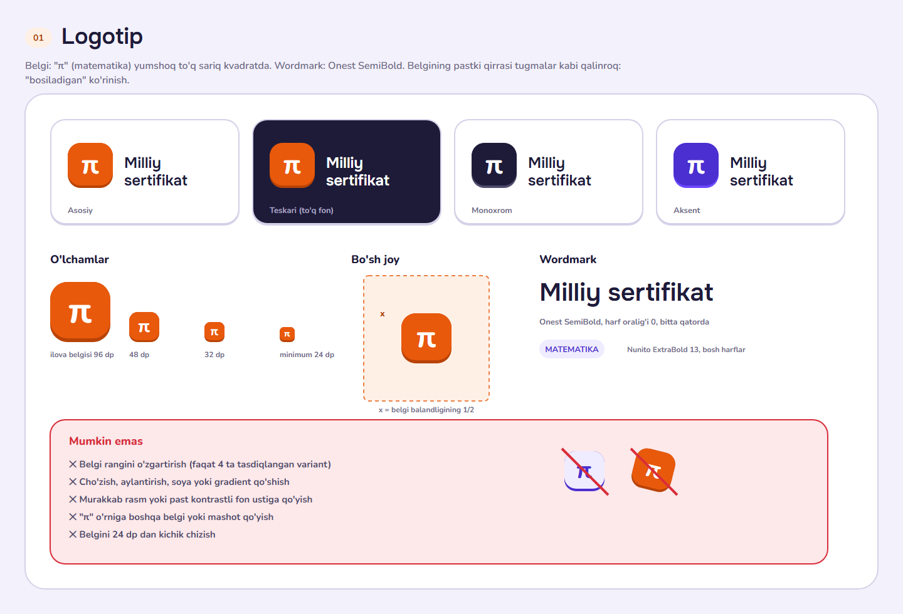
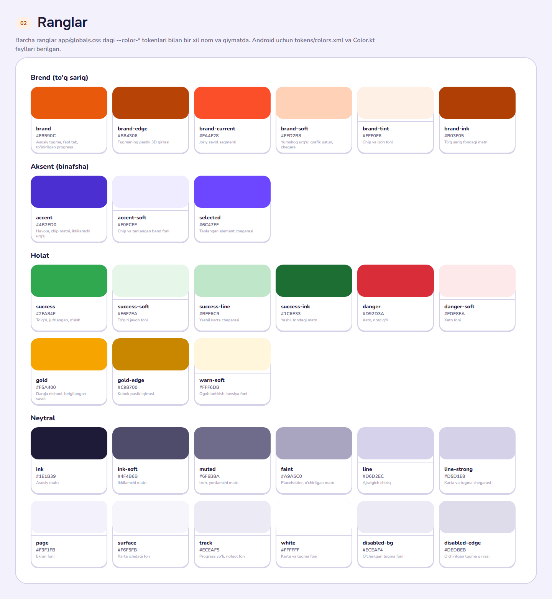
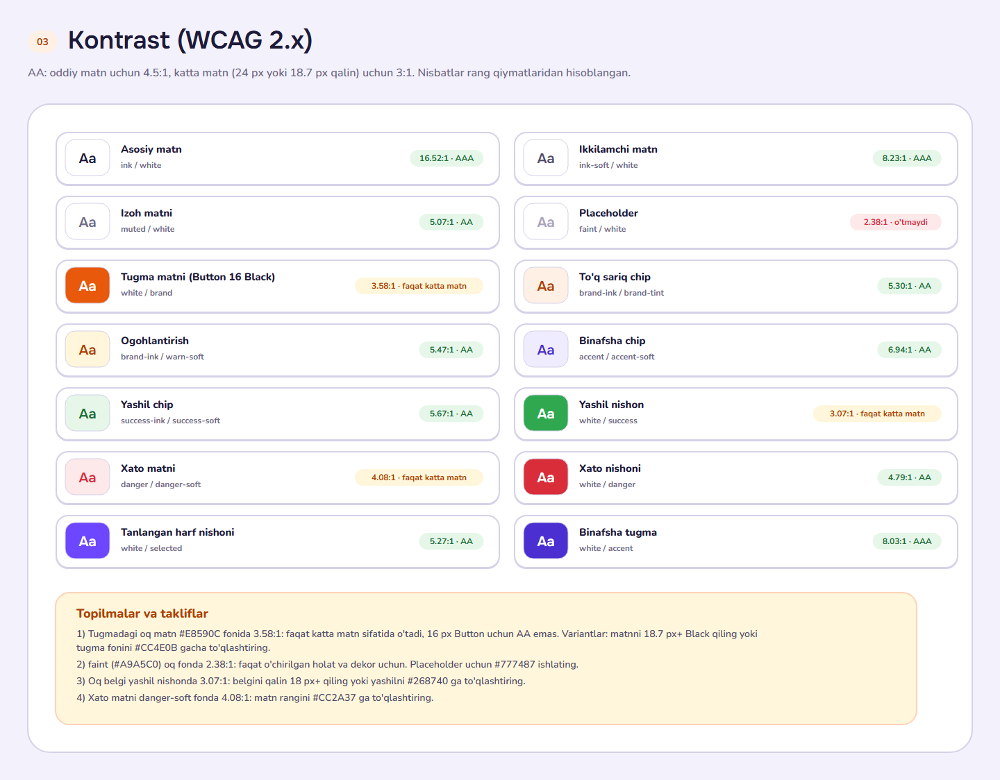
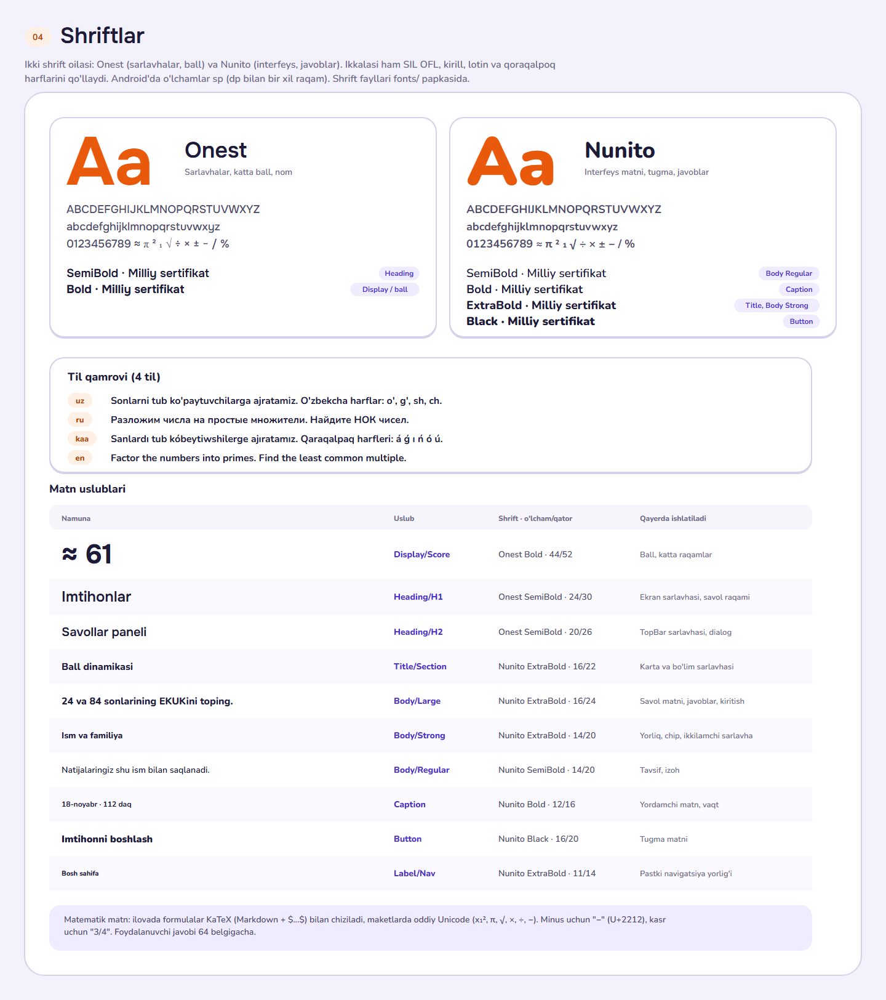
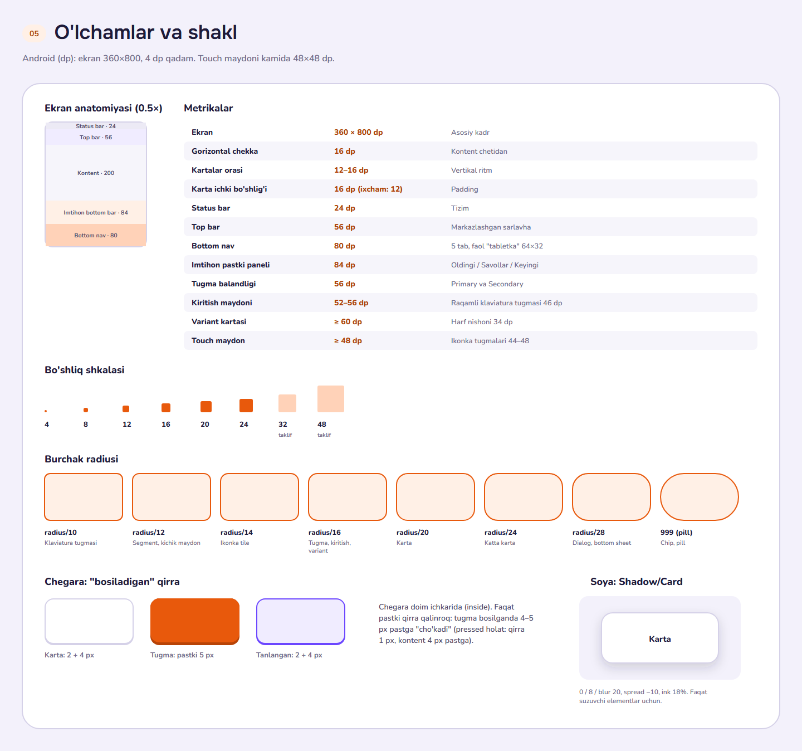
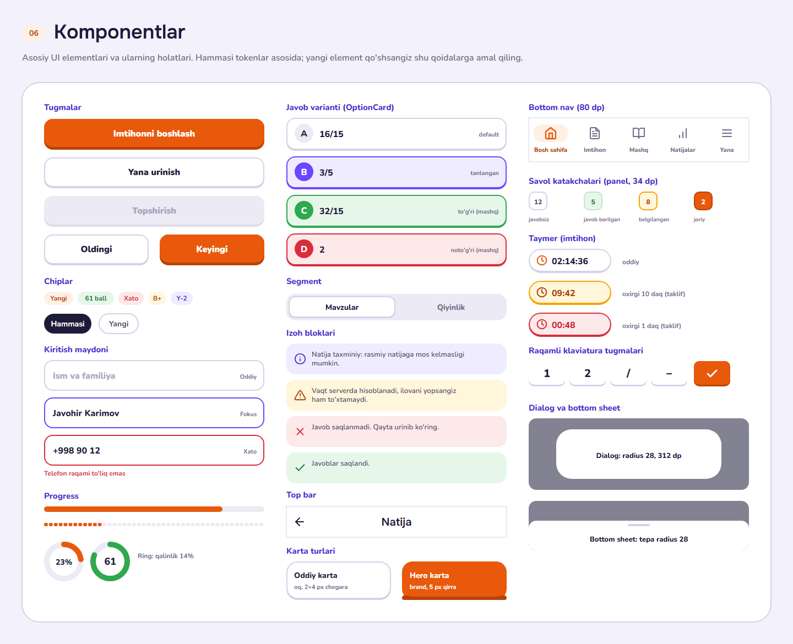
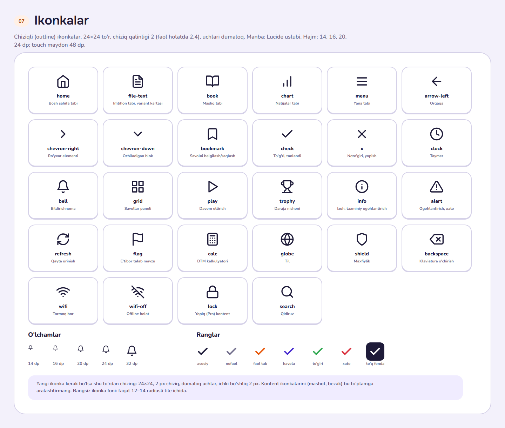
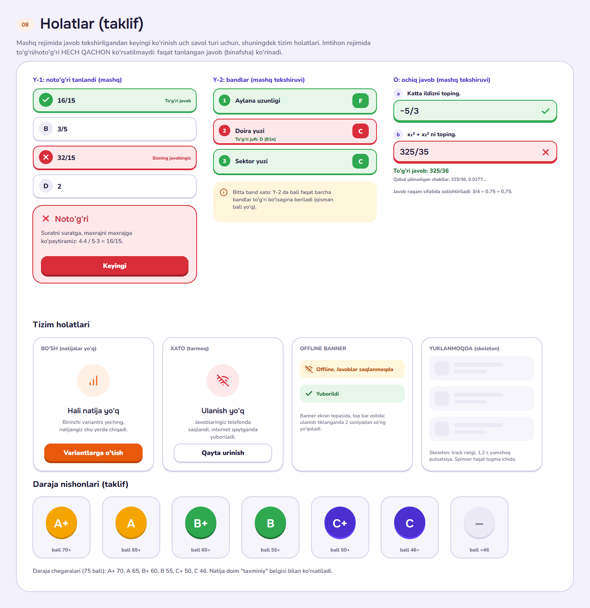
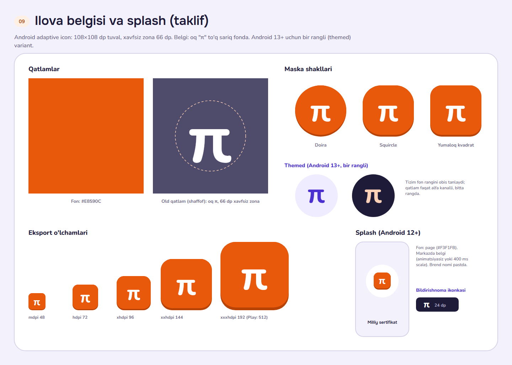
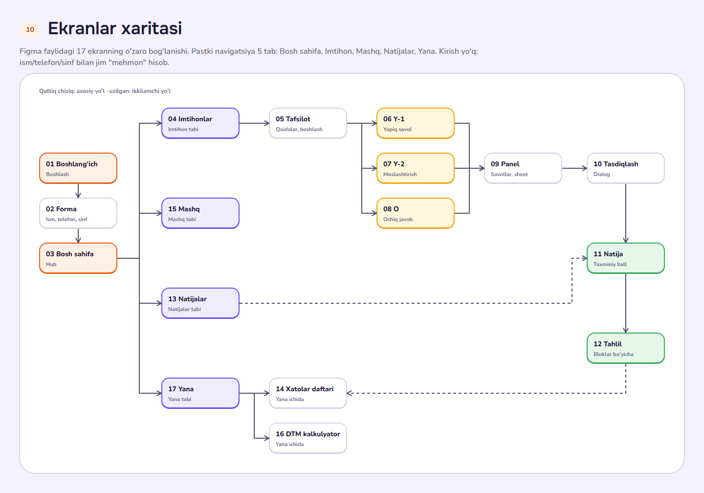

# Milliy sertifikat (Matematika): Brandbook, Android ilovasi

Versiya 1.0 · 2026-noyabr · uslub: "O'yin" (Figma B variant, [docs/design.md](../design.md)).

Bu hujjat Android ilovasi uchun brend va dizayn qoidalari: shriftlar, ranglar, o'lchamlar, komponentlar, ikonkalar, holatlar. Ko'rgazmali chizmalar `assets/` papkasida (SVG va PNG), tayyor kod tokenlari `tokens/` papkasida.

**Qanday o'qiladi.** Har bo'limda tegishli chizma ko'rsatilgan. Belgilar:
- **[Manba]**: Figma "O'yin" dizayni yoki bizning veb-ilova kodidan olingan qiymat (app/globals.css, config/*).
- **[Taklif]**: bu hujjat bilan birga taklif qilingan, hali veb-ilovada yoki Figma maketida tasdiqlanmagan qaror.

Figma maketi (17 ekran, komponentlar): https://www.figma.com/design/EgMX8rtOFvqG3RbUiL3aKO. Brandbook sahifasi Figma'da faqat qisman chizilgan (muqova, logotip, ranglar, kontrast), to'liq versiyasi shu papkada.

## 0. Mundarija

| # | Bo'lim | Chizma |
|---|--------|--------|
| 1 | Brend va ohang | [01-logotip](assets/01-logotip.png) |
| 2 | Ranglar | [02-ranglar](assets/02-ranglar.png) |
| 3 | Kontrast | [03-kontrast](assets/03-kontrast.png) |
| 4 | Shriftlar | [04-shriftlar](assets/04-shriftlar.png) |
| 5 | O'lchamlar va shakl | [05-ulchamlar-shakl](assets/05-ulchamlar-shakl.png) |
| 6 | Komponentlar | [06-komponentlar](assets/06-komponentlar.png) |
| 7 | Ikonkalar | [07-ikonkalar](assets/07-ikonkalar.png) |
| 8 | Holatlar | [08-holatlar](assets/08-holatlar.png) |
| 9 | Ilova belgisi va splash | [09-ilova-belgisi](assets/09-ilova-belgisi.png) |
| 10 | Ekranlar xaritasi | [10-ekranlar-xaritasi](assets/10-ekranlar-xaritasi.png) |
| 11 | Harakat | (matn) |
| 12 | Kontent va yozuv qoidalari | (matn) |
| 13 | Android'ga o'tkazish | `tokens/` |
| 14 | Ochiq masalalar | (matn) |

---

## 1. Brend va ohang

**Nomi:** Milliy sertifikat. **Yo'nalish:** Matematika (mock imtihon, mashq, tahlil). **Maqsad:** Milliy sertifikat imtihoniga tayyorlanuvchi o'quvchiga imtihon formatiga aynan mos mashq, taxminiy natija va tahlil berish.

**Xarakter (3 so'z):** *aniq* (raqamlar, format, qoidalar), *o'yinsimon* (qalin chegara, "bosiladigan" tugmalar, yorqin to'q sariq), *halol* (natija har doim "taxminiy", rasmiy emas).

**Belgi [Taklif].** "π" harfi yumshoq to'q sariq kvadratda (burchak radiusi balandlikning 29%). Pastki qirrasi tugmalar kabi qalinroq (balandlikning 6%, kamida 3 dp). Wordmark: "Milliy sertifikat", Onest SemiBold. Uchinchi tomon tasvirlari yoki mavjud mascot'lar logotipga aralashtirilmaydi.

| Variant | Qachon |
|---------|--------|
| Asosiy (to'q sariq belgi, oq fon) | Standart |
| Teskari (to'q `ink` fon) | Splash, to'q banner |
| Monoxrom (`ink`) | Bir rangli bosma, bildirishnoma |
| Aksent (binafsha) | Faqat ichki/test muhit (ilova belgisi bo'lmaydi) |

**Qoidalar:** minimal o'lcham 24 dp; atrofida belgi balandligining yarmicha bo'sh joy; rangni, nisbatni o'zgartirmang, soya yoki gradient qo'shmang; murakkab fonga qo'ymang.

---

## 2. Ranglar

Hammasi veb-ilovadagi [app/globals.css](../../app/globals.css) `--color-*` tokenlari bilan bir xil. Figma'da `Tokenlar` kolleksiyasi (`color/*`), Android'da `tokens/colors.xml` va `tokens/Color.kt`.

### Brend (to'q sariq)
| Token | Hex | Ishlatilishi |
|-------|-----|--------------|
| `brand` | `#E8590C` | Asosiy tugma, faol tab, to'ldirilgan progress |
| `brand-edge` | `#B84306` | Tugmaning pastki 3D qirrasi |
| `brand-current` | `#FA4F28` | Joriy savol segmenti |
| `brand-soft` | `#FFD2B8` | Yumshoq urg'u: grafik ustun, chegara |
| `brand-tint` | `#FFF0E6` | Chip va izoh foni |
| `brand-ink` | `#B03F05` | To'q sariq fondagi matn |

### Aksent (binafsha)
| Token | Hex | Ishlatilishi |
|-------|-----|--------------|
| `accent` | `#4B2FD0` | Havola, chip matni, ikkilamchi urg'u |
| `accent-soft` | `#F0ECFF` | Chip va tanlangan band foni |
| `selected` | `#6C47FF` | Tanlangan element chegarasi (Y-1 variant, Y-2 band) |

### Holat
| Token | Hex | Ishlatilishi |
|-------|-----|--------------|
| `success` | `#2FA84F` | To'g'ri, juftlangan, o'sish |
| `success-soft` | `#E6F7EA` | To'g'ri javob foni, ball kartasi |
| `success-line` | `#BFE6C9` | Yashil karta chegarasi |
| `success-ink` | `#1C6E33` | Yashil fondagi matn |
| `danger` | `#D92D3A` | Xato, noto'g'ri. **[Taxminiy]**: Figma'da xato holati chizilmagan (docs/design.md) |
| `danger-soft` | `#FDE8EA` | Xato foni (taklif, danger bilan birga) |
| `gold` / `gold-edge` | `#F5A400` / `#C98700` | Daraja nishoni, belgilangan savol |
| `warn-soft` | `#FFF6DB` | Ogohlantirish va tavsiya foni |

### Neytral
| Token | Hex | Ishlatilishi |
|-------|-----|--------------|
| `ink` | `#1E1B39` | Asosiy matn |
| `ink-soft` | `#4F4B6B` | Ikkilamchi matn |
| `muted` | `#6F6B8A` | Izoh, yordamchi matn |
| `faint` | `#A9A5C0` | Placeholder, o'chirilgan matn |
| `line` | `#D6D2EC` | Ajratgich chiziq. Figma'dagi `#E6E3F2` dan to'qroq, kartalar fondan ajralib turishi uchun (globals.css izohi) |
| `line-strong` | `#D5D1E8` | Karta va tugma chegarasi |
| `page` | `#F3F1FB` | Ekran foni |
| `surface` | `#F6F5FB` | Karta ichidagi fon |
| `track` | `#ECEAF5` | Progress yo'li, nofaol fon |
| `white` | `#FFFFFF` | Karta va tugma foni |
| `disabled-bg` / `disabled-edge` | `#ECEAF4` / `#DEDBEB` | O'chirilgan tugma |

**Ishlatish nisbati.** Ekranning ~70% neytral (`page`, `white`), ~20% `brand` oilasi (faqat harakat chaqiruvi: tugma, faol tab, joriy savol), ~10% aksent va holat. Bir ekranda bitta asosiy (primary) tugma. Qorong'i rejim yo'q (loyiha qarori: faqat yorug' mavzu).

---

## 3. Kontrast (WCAG 2.x)

Nisbatlar rang qiymatlaridan hisoblangan. AA: oddiy matn uchun 4.5:1, katta matn (24 px yoki 18.7 px qalin) uchun 3:1.

| Juftlik | Nisbat | Natija |
|---------|-------:|--------|
| ink / white | 16.52 | AAA |
| ink-soft / white | 8.23 | AAA |
| muted / white | 5.07 | AA |
| **faint / white** | **2.38** | **o'tmaydi** (placeholder) |
| **white / brand** | **3.58** | **faqat katta matn** (Button 16 Black) |
| brand-ink / brand-tint | 5.30 | AA |
| brand-ink / warn-soft | 5.47 | AA |
| accent / accent-soft | 6.94 | AA |
| success-ink / success-soft | 5.67 | AA |
| **white / success** | **3.07** | **faqat katta matn** |
| **danger / danger-soft** | **4.08** | **faqat katta matn** |
| white / danger | 4.79 | AA |
| white / selected | 5.27 | AA |
| white / accent | 8.03 | AAA |

### Topilmalar va takliflar [Taklif]
Quyidagi tuzatish ranglari 4.5:1 uchun hisoblangan (rang tonini saqlagan holda to'qlashtirish):

1. **Tugma matni.** Oq matn `#E8590C` fonida 3.58:1: 16 px Button AA emas. Variantlar: (a) Button matnini 18.7 px dan katta va qalin qiling (katta matn sifatida 3:1 yetadi); (b) tugma fonini `#CC4E0B` gacha to'qlashtiring. Qaror kerak: bu brend rangini o'zgartiradi (14-bo'lim).
2. **Placeholder.** `faint` oq fonda 2.38:1. Placeholder uchun `#777487` ishlating; `faint` faqat o'chirilgan holat va dekor uchun qolsin.
3. **Yashil nishon.** Oq belgi `success` fonida 3.07:1. Belgini 18 px+ qalin qiling yoki `success` ni `#268740` ga to'qlashtiring.
4. **Xato matni.** `danger` matni `danger-soft` fonida 4.08:1: matn rangini `#CC2A37` ga to'qlashtiring.

---

## 4. Shriftlar

Ikki oila (ikkalasi Google Fonts, SIL OFL litsenziya; fayllar `fonts/` da, litsenziya matnlari bilan):

| Oila | Vazifasi | Ishlatiladigan og'irliklar |
|------|----------|---------------------------|
| **Onest** | Sarlavhalar, ball, nom | SemiBold (600), Bold (700) |
| **Nunito** | Interfeys, tugma, javoblar, matn | SemiBold (600), Bold (700), ExtraBold (800), Black (900) |

Veb-ilovada `next/font/google` orqali Nunito va Onest ishlatiladi (app/layout.tsx), shuning uchun Android ham bir xil oilalardan foydalanadi. Ikkala shrift kirill, lotin va qoraqalpoq harflarini (á ǵ ı ń ó ú) qo'llaydi (chizmada ko'rsatilgan).

### Matn uslublari (sp = dp bilan bir xil raqam)
| Uslub | Shrift | O'lcham / qator | Qayerda |
|-------|--------|-----------------|---------|
| Display/Score | Onest Bold | 44 / 52 | Ball (≈ 61), katta raqamlar |
| Heading/H1 | Onest SemiBold | 24 / 30 | Ekran sarlavhasi, savol raqami |
| Heading/H2 | Onest SemiBold | 20 / 26 | TopBar sarlavhasi, dialog, forma sarlavhasi |
| Title/Section | Nunito ExtraBold | 16 / 22 | Karta va bo'lim sarlavhasi |
| Body/Large | Nunito ExtraBold | 16 / 24 | Savol matni, javob variantlari, kiritish |
| Body/Strong | Nunito ExtraBold | 14 / 20 | Yorliq, chip, ikkilamchi sarlavha |
| Body/Regular | Nunito SemiBold | 14 / 20 | Tavsif, izoh |
| Caption | Nunito Bold | 12 / 16 | Yordamchi matn, vaqt |
| Button | Nunito Black | 16 / 20 | Tugma matni |
| Label/Nav | Nunito ExtraBold | 11 / 14 | Pastki navigatsiya yorlig'i |

Bu uslublar Figma'da Text Styles sifatida yaratilgan (`Display/Score` ... `Label/Nav`). Veb-ilovadagi qiymatlar bilan farq: veb'da sarlavha 36/43 px (kattaroq ekran), Android'da mobil ixcham shkala qo'llaniladi **[Taklif]**.

**Matematik matn.** Ilovada formulalar KaTeX bilan (Markdown + `$...$`); Android'da shu ma'lumot formati saqlanadi va formulalar KaTeX/MathJax WebView yoki maxsus renderer bilan chiziladi. Figma maketlarida oddiy Unicode (x₁², π, √, ×, ÷, −) ishlatilgan. Minus uchun "−" (U+2212), kasr "3/4".

---

## 5. O'lchamlar va shakl

Birlik: dp, qadam 4 dp. Asosiy kadr 360 × 800.

| Element | Qiymat |
|---------|--------|
| Gorizontal chekka | 16 dp |
| Kartalar orasi | 12–16 dp |
| Karta ichki bo'shlig'i | 16 dp (ixcham: 12) |
| Status bar | 24 dp (tizim) |
| Top bar | 56 dp, sarlavha markazda |
| Bottom nav | 80 dp, 5 tab, faol "tabletka" 64 × 32 |
| Imtihon pastki paneli | 84 dp: Oldingi / Savollar / Keyingi |
| Tugma balandligi | 56 dp |
| Kiritish maydoni | 52–56 dp |
| Raqamli klaviatura tugmasi | 46 dp |
| Variant kartasi | ≥ 60 dp, harf nishoni 34 dp |
| Touch maydon | ≥ 48 × 48 dp (ikonka tugmalari 44–48) |

**Bo'shliq shkalasi:** 4, 8, 12, 16, 20, 24 (Figma `space/*`). 32 va 48 **[Taklif]** (katta bo'limlar orasi).

**Burchak radiusi:** 10 (klaviatura tugmasi), 12 (segment, kichik maydon), 14 (ikonka tile), **16 (tugma, kiritish, variant)**, **20 (karta)**, 24 (katta karta), 28 (dialog, bottom sheet tepa), 999 (chip, pill). Veb tokenlari: 16, 24, 999; qolganlari mobil maket uchun qo'shildi.

**Chegara va "bosiladigan" qirra [Manba].** Chegara 2 dp, doim ichkarida (inside). Karta va tanlash elementlarida pastki chegara 4 dp, tugmada 5 dp (`brand-edge`). Bosilganda qirra 1 dp ga kamayadi va kontent 4 dp pastga tushadi ("cho'kadi") **[Taklif]**.

**Soya [Manba/Taklif].** `Shadow/Card`: 0 / 8 / blur 20 / spread −10, `ink` 18%. Faqat suzuvchi elementlarda (dialog, bottom sheet); oddiy kartalarda chegara yetarli.

---

## 6. Komponentlar

Figma "Komponentlar" sahifasida mavjud: StatusBar, TopBar (Right = none/menu/bookmark), BottomNav (Faol = home/exam/practice/history/more), Button/Primary, Button/Secondary, OptionCard (Holat = default/selected/correct/wrong). Qolganlari ekranlarda inline chizilgan.

| Komponent | Qoidalar |
|-----------|----------|
| **Button/Primary** | 56 dp, radius 16, fon `brand`, pastki qirra 5 dp `brand-edge`, matn Button (oq). Bir ekranda bittadan ortiq emas. |
| **Button/Secondary** | 56 dp, oq fon, 2 dp `line-strong`, pastki 4 dp, matn `ink`. |
| **Button disabled** | fon `disabled-bg`, qirra `disabled-edge`, matn `faint`. |
| **Chip** | Pill, Caption 12 Bold, ichki 10 × 4 dp. Tur: `brand-tint`/`brand-ink` (yangi, jarayonda), `success-soft`/`success-ink` (ball), `danger-soft`/`danger` (xato), `accent-soft`/`accent` (tur). Filtr chip: tanlangan `ink` fon + oq matn; tanlanmagan oq + 2 dp chegara. |
| **Kiritish maydoni** | 56 dp, radius 16, 2 dp chegara: oddiy `line-strong`, fokus `selected`, xato `danger` + 12 px xato matni ostida. |
| **OptionCard (variant)** | ≥ 60 dp, radius 16, chap tomonda 34 dp harf nishoni (A–D), 2 dp chegara + 4 dp pastki. Holatlar: default (oq), selected (`accent-soft` + `selected`), correct (`success-soft` + `success`), wrong (`danger-soft` + `danger`). |
| **Segment** | `track` fon, radius 16, ichki 4 dp; faol element oq, 2 dp chegara. |
| **Izoh bloki** | radius 16, ikonka 22 + 13 px matn. Tur: info (`accent-soft`), ogohlantirish (`warn-soft`), xato (`danger-soft`), muvaffaqiyat (`success-soft`). |
| **Progress** | Chiziq: 10 dp, `track` yo'l, `brand` to'lish. Imtihon: 45 ta ingichka segment (6 dp), o'tgani `brand`, joriy `brand-current`, qolgani `track`. Ring: qalinlik radiusning 14%. |
| **Savol katakchasi (panel)** | 34 × 34 dp, radius 10: javobsiz (oq), javob berilgan (`success-soft`), belgilangan (`warn-soft` + `gold` chegara), joriy (`brand`). |
| **Taymer chipi** | pill, 44 dp, soat ikonkasi + vaqt (Title 16). Holatlar: oddiy, oxirgi 10 daq (`warn-soft` + `gold`), oxirgi 1 daq (`danger-soft` + `danger`) **[Taklif]**. |
| **Top bar** | 56 dp, orqaga 48 × 48, sarlavha markazda (H2). |
| **Bottom nav** | 80 dp, oq, yuqorida 1 dp `line`. Faol: `brand-tint` tabletka 64 × 32, ikonka `brand` 2.4 qalinlik, yorliq `brand-ink`; nofaol: `muted`. |
| **Dialog** | radius 28, 312 dp kenglik, ikonka + sarlavha (H2) + matn + ustma-ust tugmalar. Fon xiralashtiriladi (`ink` ~55%). |
| **Bottom sheet** | tepa radius 28, ushlagich 40 × 4 dp `line`. Savollar paneli uchun ishlatiladi. |
| **Raqamli klaviatura** | 4 × 4 tugma, 46 dp, radius 10; oxirgi tugma `brand` (✓). O (ochiq) javob uchun: `1–9`, `0`, `−`, `/`, `,`, `.`, ⌫, ✓. |

Imtihon rejimida javob to'g'ri/noto'g'ri deb ko'rsatilmaydi (faqat tanlangan, binafsha). To'g'ri/noto'g'ri holatlar faqat **mashq** rejimida va natija tahlilida ishlatiladi.

---

## 7. Ikonkalar

Chiziqli (outline), 24 × 24 to'r, chiziq 2 (faol holatda 2.4), uchlari dumaloq. Uslub Lucide'ga o'xshash; Figma maketidagi ikonkalar shu yo'llar bilan chizilgan, shuning uchun to'plam o'zgarishsiz kodga ko'chadi (har ikonka `assets/07-ikonkalar.svg` da).

Hajm: 14 (chip ichida), 16, 20, 24 (standart), 32+ (bo'sh holat). Touch maydon doim 48 dp. Rang: `ink` (asosiy), `muted` (nofaol), `brand` (faol tab), `accent` (havola), `success`/`danger` (holat), oq (to'q fonda).

Ro'yxat (28 ta): home, file-text, book, chart, menu, arrow-left, chevron-right, chevron-down, bookmark, check, x, clock, bell, grid, play, trophy, info, alert, refresh, flag, calc, globe, shield, backspace, wifi, wifi-off, lock, search. Yangi ikonka shu to'rga mos chizilishi shart.

Veb-ilovadagi mascot va dekorativ tasvirlar (`public/art`) ikonka to'plamiga aralashtirilmaydi; ular faqat bo'sh holat va muvaffaqiyat illyustratsiyalarida mumkin **[Taklif]**.

---

## 8. Holatlar [Taklif]

### 8.1. Javob tekshiruvi (faqat mashq rejimi)
- **Y-1:** to'g'ri variant `success` (ichida ✓), tanlangan xato variant `danger` (✕) va "Sizning javobingiz" yorlig'i. Pastda javob oynasi: "To'g'ri" (yashil) yoki "Noto'g'ri" (qizil), qisqa yechim, "Keyingi".
- **Y-2:** har band alohida: to'g'ri juftlik yashil, xato juftlik qizil va ostida "To'g'ri juft: D". Bahosi **hammasi yoki hech narsa**: ball faqat barcha bandlar to'g'ri bo'lsa beriladi (lib/exam/scoring.ts: `entries.every(...)`).
- **O:** maydon yashil (✓) yoki qizil (✕). Xato bo'lsa "To'g'ri javob: ..." va qabul qilinadigan shakllar. Javob raqam sifatida solishtiriladi: `3/4`, `0.75`, `0,75` teng. a va b bandlar alohida baholanadi.

### 8.2. Taymer
Oddiy (oq, `brand` soat), oxirgi 10 daqiqa (sariq), oxirgi 1 daqiqa (qizil). Vaqt serverda hisoblanadi (DB soati), shuning uchun pauza tugmasi yo'q; ilova yopilsa ham vaqt ketadi.

### 8.3. Tizim holatlari
| Holat | Ko'rinish |
|-------|-----------|
| Bo'sh (natija yo'q) | 80 dp doira ichida ikonka, H2 sarlavha, 1 qator tavsif, Primary tugma |
| Xato (tarmoq) | qizil doira + wifi-off, "Ulanish yo'q", Secondary "Qayta urinish" |
| Offline banner | top bar ostida `warn-soft` blok; ulanish tiklanganda yashil "Yuborildi" 2 soniya |
| Yuklanmoqda | skeleton (`track`, 1.2 s yumshoq pulsatsiya); spinner faqat tugma ichida |

Offline matni ("Javoblaringiz telefonda saqlandi, internet qaytganda yuboriladi") Android ilovasi javoblarni lokal saqlab, keyin yuborishi shartiga bog'liq: veb'dagi saqlash navbati (lib/exam) asosida, lekin mobil uchun alohida qaror kerak (14-bo'lim).

### 8.4. Daraja nishonlari
75 balldan: A+ 70+, A 65+, B+ 60+, B 55+, C+ 50+, C 46+ (config/exam-format.math-v1.ts). Nishon 76 dp doira, pastki qirra 4 dp: A+/A oltin (`gold`), B+/B yashil, C+/C binafsha, 46 dan past neytral. Natija doim "taxminiy" yorlig'i bilan.

---

## 9. Ilova belgisi va splash [Taklif]

- **Adaptive icon:** 108 × 108 dp tuval, xavfsiz zona 66 dp doira. Fon qatlam: `#E8590C` bir rang; old qatlam: oq "π" (shaffof fon). Doira, squircle va yumaloq kvadrat maskalarida ham o'qiladi.
- **Themed (Android 13+):** bir rangli qatlam; tizim rang beradi.
- **Eksport:** mdpi 48, hdpi 72, xhdpi 96, xxhdpi 144, xxxhdpi 192; Play Store uchun 512 × 512.
- **Splash (Android 12+ SplashScreen API):** fon `page`, markazda belgi; animatsiya yo'q yoki 400 ms scale.
- **Bildirishnoma ikonkasi:** 24 dp, faqat shaffof fonda oq "π".

---

## 10. Ekranlar xaritasi

17 ekran (Figma "Ekranlar" sahifasi): 01 Boshlang'ich · 02 Forma · 03 Bosh sahifa · 04 Imtihonlar ro'yxati · 05 Imtihon tafsiloti · 06 Imtihon Y-1 · 07 Y-2 · 08 O · 09 Savollar paneli · 10 Topshirishni tasdiqlash · 11 Natija · 12 Tahlil · 13 Natijalar tarixi · 14 Xatolar daftari · 15 Mashq · 16 DTM kalkulyatori · 17 Yana.

Navigatsiya: pastki 5 tab (Bosh sahifa, Imtihon, Mashq, Natijalar, Yana). Xatolar daftari, Saqlangan savollar, DTM kalkulyatori, Til va Maxfiylik "Yana" ichida. Kirish yo'q: ism-familiya, telefon, sinf, rozilik bilan jim "mehmon" hisob (docs/auth.md).

**Layout manbasi.** Joylashuv g'oyalari (pastki navigatsiya, ball kartasi, imtihon ekranidagi taymer va raqam qatori, natija halqasi, bloklar bo'yicha tahlil) foydalanuvchi bergan tashqi mobil ilova konsepsiyasidan olingan; uning ranglari, shriftlari, ikonkalari va logotipi **olinmagan**: ko'rinish faqat bizning tokenlar bilan.

---

## 11. Harakat

[Manba: app/globals.css] Veb'da: o'ng tomondan ochiladigan panel `0.22 s ease-out`; tepadan tushadigan javob oynasi `0.3 s cubic-bezier(0.22, 1, 0.36, 1)`; orqa fon xiralashtiriladi. **Tizim sozlamasi "harakatni kamaytirish" yoqilgan bo'lsa animatsiya o'chiriladi.**

[Taklif] Android uchun: ekranlar o'rtasida standart Material o'tishi (200–300 ms); tugma bosilganda "cho'kish" 80 ms; to'g'ri javobda belgi 150 ms scale; progress ring to'lishi 600 ms ease-out. Hech qanday cheksiz takrorlanuvchi animatsiya (skeleton pulsatsiyasidan tashqari).

---

## 12. Kontent va yozuv qoidalari

- **Til:** o'zbek (lotin) asosiy; ru, kaa (qoraqalpoq lotin), en qo'shimcha. Admin faqat o'zbekcha. Tarjimada raqamlar, kalit va variant harflari bir xil, faqat matn tarjima qilinadi.
- **Apostrof:** o'zbek va qoraqalpoq matnida to'g'ri apostrof `'` (o', g', ma'no); typografik variantlarni aralashtirmang.
- **Taxminiy natija:** ball har doim "≈ 61 / 75" va "taxminiy" belgisi bilan. "Rasmiy" so'zi ishlatilmaydi. Taxminiy ball: 75 shkala; daraja chegaralari 3-bo'limdagi jadval.
- **DTM:** A+ va A maksimal ball; B+, B, C+, C proporsional (`ball / 65 × maksimal`, maksimal 93 / 63 / 11); majburiy fanda har qanday daraja maksimal. Hisob-kitob "taxminiy" (config/dtm.ts izohlari).
- **Raqam va belgilar:** minus "−" (U+2212), ko'paytirish "×" yoki "·", kasr "3/4", o'nli kasr nuqta yoki vergul qabul qilinadi (kiritishda). Foiz: "73%" (bo'shliqsiz).
- **Tugma matni:** fe'l, 1–3 so'z: "Boshlash", "Keyingi", "Topshirish", "Yana urinish". Tugmada ikki fe'l yoki nuqta yo'q.
- **Ohang:** to'g'ridan-to'g'ri, ayblamaydigan. Xato: "Noto'g'ri" + sababi; "Siz xato qildingiz" demaymiz. Ogohlantirish: nima bo'lishi + nima qilish kerakligi.
- **Savol turlari nomi:** Y-1 (yopiq), Y-2 (moslashtirish), O (ochiq). Bo'limlar: Sonlar, Algebra, Tenglama, Funksiyalar, Analiz, Geometriya, To'plam va ehtimollik.
- **Kontent:** faqat original savollar (haqiqiy imtihon savollari ko'chirilmaydi); format konfiguratsiyada (config/exam-format.math-v1.ts).

---

## 13. Android'ga o'tkazish

`tokens/` papkasi:

| Fayl | Nima |
|------|------|
| `tokens.json` | Barcha tokenlar (rang + ishlatilishi, matn uslublari, bo'shliq, radius, o'lcham, harakat, daraja) |
| `colors.xml` | Android ranglar resursi (`res/values/colors.xml`) |
| `dimens.xml` | Bo'shliq, radius, o'lchamlar (`res/values/dimens.xml`) |
| `Color.kt` | Jetpack Compose ranglar |
| `Type.kt` | Compose `TextStyle` lar (Nunito va Onest o'zgaruvchan shriftlari, API 26+) |

Shrift fayllari (`fonts/Nunito.ttf`, `fonts/Onest.ttf`) `res/font/` ga `nunito.ttf` va `onest.ttf` nomi bilan ko'chiriladi. Kod paket nomi (`uz.milliysertifikat`) taxminiy; haqiqiy nomga almashtiring.

**Qayta generatsiya.** SVG: `node docs/brandbook/build.cjs`; PNG (Chrome/Edge kerak): `node docs/brandbook/render.cjs`; tokenlar: `node docs/brandbook/tokens.cjs`. Ranglar o'zgarsa avval [app/globals.css](../../app/globals.css) va `build.cjs` dagi `C` obyektini birga yangilang.

---

## 14. Ochiq masalalar (qaror kerak)

1. **Brend rangi va kontrast.** `#E8590C` fonida oq matn AA emas (3.58:1). Tugmani `#CC4E0B` ga to'qlashtirish yoki Button matnini 18.7 px+ qilish. Veb-ilova va Figma dizayni bilan mos qolishi uchun ikkalasini birga o'zgartirish kerak.
2. **Xato rangi.** `danger` `#D92D3A` taxminiy (Figma'da xato holati ko'rilmagan). Figma'dagi "Eslaymiz: noto'g'ri" freymi (`2010:15680`) o'qilsa aniqlanadi.
3. **Offline rejim.** Mobil ilova javoblarni lokal saqlab keyin yuborishi kerakmi? Hozirgi veb-ilovada saqlash navbati bor, ammo Android uchun qaror yo'q.
4. **Taymer ogohlantirishlari** (10 daq / 1 daq) va **daraja nishonlari** yangi takliflar: mutaxassis va mahsulot egasi tasdiqlashi kerak.
5. **Ilova belgisi.** "π" belgisi taklif; mavjud mascot ishlatilsinmi yoki yo'qmi, brend qarori.
6. **Matematik matn renderi.** Android'da KaTeX uchun WebView yoki native kutubxona tanlovi.
7. **Figma brandbook sahifasi** faqat qisman: Figma MCP tarif limiti tufayli shriftlar, o'lchamlar, komponentlar, ikonkalar, holatlar bo'limlari Figma'ga chizilmadi (ular shu papkada SVG/PNG sifatida bor). Limit tiklanganda Figma'ga ko'chirish mumkin.
